<!-- hero: monochrome ASCII portrait (types in) beside a neofetch-style info
     panel. regenerate portrait: python scripts/prep_photo.py <photo> &&
     python scripts/make_ascii_svg.py ; info panel: python scripts/make_info_card.py -->

<!-- animated contribution graph: real data, boxes reveal cell by cell
     (regenerated daily by .github/workflows/update-profile-art.yml) -->

<h3><code>vinciarya@github ~ $ ./contributions.sh</code></h3>

 
 

<!-- self-updating newspaper front page: real daily dev news (GitHub Releases,
     HN, GitHub Search, endoflife.date, Statuspage), regenerated daily by
     .github/workflows/daily-feed.yml. Pipeline: scripts/fetch.py -> data/feed.json
     -> scripts/newspaper.py -> scripts/readme_index.py. Everything between the
     daily-commit markers below is generated -- edit readme_index.py, not this. -->

<h3><code>vinciarya@github ~ $ ./the-daily-commit.sh</code></h3>

<!-- daily-commit:start -->

 [Gemini 4 Argon](https://deepmind.google/models/gemini/) `1213 pts` · [Redesigning source control at…](https://www.anthropic.com/engineering/redesigning-source-control) `710 pts` · [OpenAI engineer arrested in bugging…](https://sfstandard.com/2026/10/13/openai-engineer-arrested-alleged-bugging-executive-conference-room/) `533 pts` 
 [mattpocock/skills](https://github.com/mattpocock/skills) `+1,553★` · [DietrichGebert/ponytail](https://github.com/DietrichGebert/ponytail) `+830★` · [deepseek-ai/deepseek-harness](https://github.com/deepseek-ai/deepseek-harness) `+650★` · [affaan-m/ECC](https://github.com/affaan-m/ECC) `+624★` 
 [Apple HomeView](https://www.apple.com/apple-homeview/) `715 pts` · [11 year old unsoundness bugs found in…](https://github.com/rust-lang/rust/issues/164250) `710 pts` · [Firefox Enterprise](https://www.firefox.com/en-US/enterprise/) `697 pts` · [CFTC Staff Were Told to Retract…](https://www.bloomberg.com/news/features/2026-10-13/cftc-staff-told-to-retract-analysis-of-suspicious-oil-trades-on-iran) `447 pts` 
 [Show HN: Guitoro, a virtual guitar…](https://guitoro.com/) `392 pts` · [Show HN: Use your OpenAI subscription…](https://pdftomp3.com/connect-ai/) `161 pts` · [wheresryan22/anatomy](https://github.com/wheresryan22/anatomy) `8.7k★` · [mhtsec/ARTEX](https://github.com/mhtsec/ARTEX) `4.0k★` 
 [Cloudflare 1min](https://www.cloudflarestatus.com/incidents/z7vongh8rqc1) `major`

<!-- daily-commit:end -->

 
 

<h3><code>vinciarya@github ~ $ whoami</code></h3>

<table>
<tr>
<td valign="top"></td>
<td valign="top"></td>
</tr>
</table>

 
 

<h3><code>vinciarya@github ~ $ ./links.sh</code></h3>

<b>Software Engineer ·  AI Builder</b>

 

