<!-- hero: monochrome ASCII portrait (types in) beside a neofetch-style info
     panel. regenerate portrait: python scripts/prep_photo.py <photo> &&
     python scripts/make_ascii_svg.py ; info panel: python scripts/make_info_card.py -->

<!-- animated contribution graph: real data, boxes reveal cell by cell
     (regenerated daily by .github/workflows/update-profile-art.yml) -->

<h3><code>vinciarya@github ~ $ ./contributions.sh</code></h3>

 
 

<!-- self-updating newspaper front page: real daily dev news (GitHub Releases,
     HN, GitHub Search, endoflife.date, Statuspage), regenerated daily by
     .github/workflows/daily-feed.yml. Pipeline: scripts/fetch.py -> data/feed.json
     -> scripts/newspaper.py -> scripts/readme_index.py. Everything between the
     daily-commit markers below is generated -- edit readme_index.py, not this. -->

<h3><code>vinciarya@github ~ $ ./the-daily-commit.sh</code></h3>

<!-- daily-commit:start -->

 [stablyai/orca](https://github.com/stablyai/orca) `+965★` · [firecrawl/firecrawl](https://github.com/firecrawl/firecrawl) `+886★` · [bookwjitchieni1986/blender-ai-mcp-addo…](https://github.com/bookwjitchieni1986/blender-ai-mcp-addon) `+818★` · [mattpocock/skills](https://github.com/mattpocock/skills) `+760★` 
 [Lean verification of the Riemann…](https://leanprover-community.github.io/blog/posts/riemann-hypothesis/) `1015 pts` · [Detonating a pile of lead azide](https://www.science.org/content/blog-post/detonating-huge-pile-lead-azide-really) `602 pts` · [My monitor was cutting my download…](https://blog.tymscar.com/posts/studiodisplayethernet/) `574 pts` · [Inkling-2-Mini in 5.4 GB Memory](https://github.com/ShinMegamiBoson/lookatmyquant) `453 pts` 
 [Show HN: Zero C# – C# without a…](https://onurgumus.github.io/zero-csharp/index.html) `159 pts` · [ItsNotRexed/Leonida](https://github.com/ItsNotRexed/Leonida) `8.4k★` · [erkamyaman/rust-anything](https://github.com/erkamyaman/rust-anything) `7.6k★` · [krisgfx9/Wireless-Device-Battery-Monit…](https://github.com/krisgfx9/Wireless-Device-Battery-Monitor) `5.9k★`

<!-- daily-commit:end -->

 
 

<h3><code>vinciarya@github ~ $ whoami</code></h3>

<table>
<tr>
<td valign="top"></td>
<td valign="top"></td>
</tr>
</table>

 
 

<h3><code>vinciarya@github ~ $ ./links.sh</code></h3>

<b>Software Engineer ·  AI Builder</b>

 

