<!-- hero: monochrome ASCII portrait (types in) beside a neofetch-style info
     panel. regenerate portrait: python scripts/prep_photo.py <photo> &&
     python scripts/make_ascii_svg.py ; info panel: python scripts/make_info_card.py -->

<!-- animated contribution graph: real data, boxes reveal cell by cell
     (regenerated daily by .github/workflows/update-profile-art.yml) -->

<h3><code>vinciarya@github ~ $ ./contributions.sh</code></h3>

 
 

<!-- self-updating newspaper front page: real daily dev news (GitHub Releases,
     HN, GitHub Search, endoflife.date, Statuspage), regenerated daily by
     .github/workflows/daily-feed.yml. Pipeline: scripts/fetch.py -> data/feed.json
     -> scripts/newspaper.py -> scripts/readme_index.py. Everything between the
     daily-commit markers below is generated -- edit readme_index.py, not this. -->

<h3><code>vinciarya@github ~ $ ./the-daily-commit.sh</code></h3>

<!-- daily-commit:start -->

 [Anthropic IPO](https://ipo.anthropic.com/us/) `919 pts` · [Gemini 4 Hydrogen](https://blog.google/innovation-and-ai/models-and-research/gemini-models/introducing-gemini-4-hydrogen/) `525 pts` · [Gemini 4 Hydrogen and Orchestrator](https://antigravity.google/blog/gemini-4-hydrogen-in-google-antigravity/) `407 pts` 
 [stablyai/orca](https://github.com/stablyai/orca) `+1,051★` · [mattpocock/skills](https://github.com/mattpocock/skills) `+914★` · [debpalash/VoiceStudio](https://github.com/debpalash/VoiceStudio) `+828★` · [deepseek-ai/deepseek-harness](https://github.com/deepseek-ai/deepseek-harness) `+787★` 
 [Jensen Huang resigns](https://apnews.com/article/nvidia-megaspeed-china-singapore-huang-5403f152a601cf82ce939f1d24fffa0f) `3482 pts` · [Service degradation on Microsoft 365](https://status.cloud.microsoft/) `854 pts` · [Rust 1.100](https://blog.rust-lang.org/2026/11/12/Rust-1.100.0/) `655 pts` · [Nvidia employees petition to bring…](https://www.wired.com/story/nvidia-employees-petition-for-jensen-huangs-return/) `555 pts` 
 [Show HN: My $300 embroidery machine…](https://github.com/simpsoka/zigzag) `502 pts` · [huamidev/GestaltX](https://github.com/huamidev/GestaltX) `7.1k★` · [tangerineturtle1/NX2navi](https://github.com/tangerineturtle1/NX2navi) `3.7k★` · [jhaizhou-ops/S2Arm](https://github.com/jhaizhou-ops/S2Arm) `2.8k★` 
 [Anthropic 914min](https://stspg.io/m0rbx38nmy1c) `major`

<!-- daily-commit:end -->

 
 

<h3><code>vinciarya@github ~ $ whoami</code></h3>

<table>
<tr>
<td valign="top"></td>
<td valign="top"></td>
</tr>
</table>

 
 

<h3><code>vinciarya@github ~ $ ./links.sh</code></h3>

<b>Software Engineer ·  AI Builder</b>

 

