<!-- hero: monochrome ASCII portrait (types in) beside a neofetch-style info
     panel. regenerate portrait: python scripts/prep_photo.py <photo> &&
     python scripts/make_ascii_svg.py ; info panel: python scripts/make_info_card.py -->

<!-- animated contribution graph: real data, boxes reveal cell by cell
     (regenerated daily by .github/workflows/update-profile-art.yml) -->

<h3><code>vinciarya@github ~ $ ./contributions.sh</code></h3>

 
 

<!-- self-updating newspaper front page: real daily dev news (GitHub Releases,
     HN, GitHub Search, endoflife.date, Statuspage), regenerated daily by
     .github/workflows/daily-feed.yml. Pipeline: scripts/fetch.py -> data/feed.json
     -> scripts/newspaper.py -> scripts/readme_index.py. Everything between the
     daily-commit markers below is generated -- edit readme_index.py, not this. -->

<h3><code>vinciarya@github ~ $ ./the-daily-commit.sh</code></h3>

<!-- daily-commit:start -->

 [Much shorter version of GRH Lean…](https://github.com/lsernau/grh-lean) `459 pts` · [The New York Times warns…](https://www.theverge.com/ai-artificial-intelligence/1041227/the-new-york-times-warns-photographers-not-to-update-photoshop-over-ai-features) `394 pts` · [OpenAI cuts GPT-6.2 usage: Astra hits…](https://twitter.com/thsottiaux/status/2125784147889393806) `258 pts` 
 [morluto/rea](https://github.com/morluto/rea) `+1,262★` · [firecrawl/firecrawl](https://github.com/firecrawl/firecrawl) `+1,005★` · [obra/superpowers](https://github.com/obra/superpowers) `+798★` · [mattpocock/skills](https://github.com/mattpocock/skills) `+660★` 
 [Holy shit holy shit holy shit holy…](https://scottaaronson.blog/?p=10379) `1563 pts` · [1Password Security Incident](https://1password.com/blog/update-on-nov-2026-security-incident) `1440 pts` · [Google releases Cogentic papers on…](https://github.com/google-research/google-research/tree/master/cogentic_research_papers) `494 pts` · [Rumors swirling that labs might have…](https://www.reddit.com/r/singularity/comments/1y59ef1/rumor_that_openai_or_anthropic_found_a_way_to/) `492 pts` 
 [Marvisak/VIctory](https://github.com/Marvisak/VIctory) `12.9k★` · [xcl-dev/xcl](https://github.com/xcl-dev/xcl) `8.4k★` · [4lwayz/portwatch-vi](https://github.com/4lwayz/portwatch-vi) `4.8k★` · [EL4CTEO/fast-anything](https://github.com/EL4CTEO/fast-anything) `4.1k★` 
 [GitHub 56min](https://stspg.io/5qj9j0p5g4cr) `critical`

<!-- daily-commit:end -->

 
 

<h3><code>vinciarya@github ~ $ whoami</code></h3>

<table>
<tr>
<td valign="top"></td>
<td valign="top"></td>
</tr>
</table>

 
 

<h3><code>vinciarya@github ~ $ ./links.sh</code></h3>

<b>Software Engineer ·  AI Builder</b>

 

